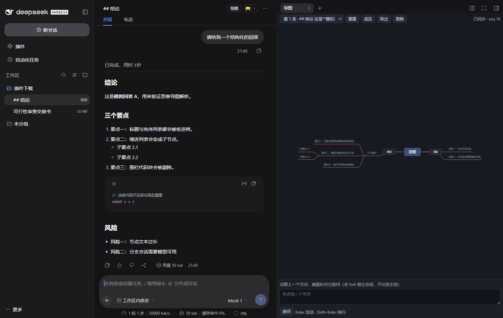
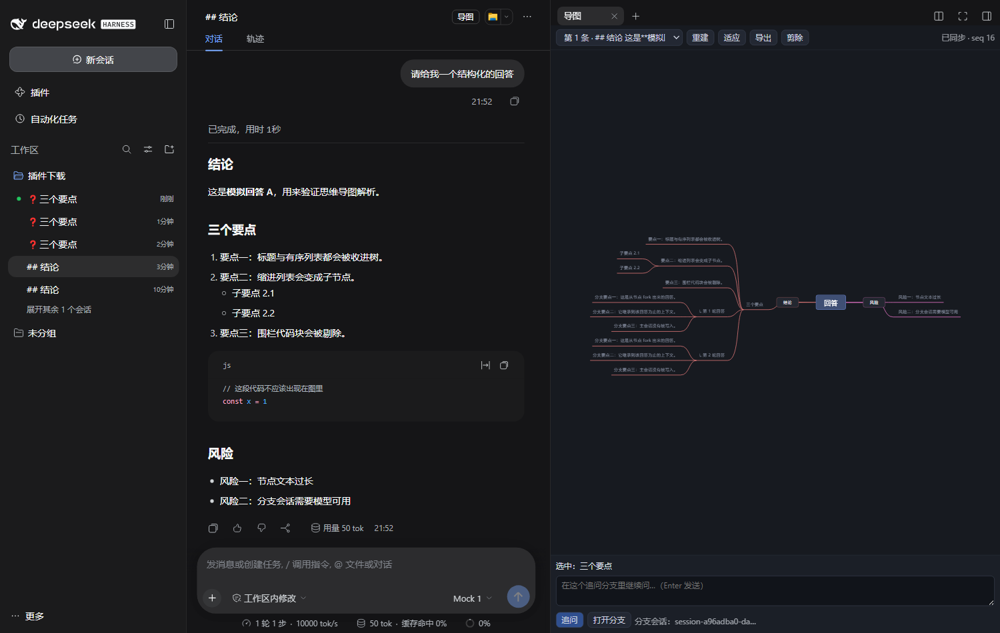

# dsh-node-mindmap

把一条 AI 回复里的 Markdown 分点结构渲染成右侧栏思维导图；点任意节点，带上下文开一个**独立 fork 会话**追问，回答长成该节点的子枝，不污染主对话。



## 功能

- **按轮建图**：每条有文本的 AI 回答一棵图，面板顶部可切换轮次；主会话来了新回答时自动跟到最新。
- **用户问题当根**：图中央节点是这一轮用户的输入（超过 30 字折叠）；AI 回答的分点直接挂在根下。
- **追问分支**：点节点 → 底部追问框 → `session/fork` 切在该回答的 seq 上，子会话继承此前上下文；分支节点显示这次追问的内容（超过 30 字折叠）。
- **折叠与展开**：用户问题 30 字、AI 回答分点 60 字以上折叠；点节点上的「展开」标签、双击节点，或选中后点工具栏「展开」，会弹出**置顶可拖动的全文框**（带「取消」），不把长文撑进导图。
- **缩放与平移**：滚轮围绕鼠标位置缩放，左键拖动平移；＋/－/适应按钮；首次适配后点击节点、展开全文不会重置视角。
- **分支会话隐藏**：侧栏默认隐藏由追问创建的子会话（按插件记录的 id 集合 + `❓` 前缀兜底），面板工具栏「分支：隐藏 / 显示」可切换；隐藏只作用于侧栏列表，`session/list` 和「打开分支」不受影响。
- **文件归属**：宿主半侧 `/api/node-mindmap.summary` 读取 `workspaceChanges`，把该轮分支产出的文件挂到回答节点上。
- **剪除 / 导出**：剪除只从图上移除节点，不改会话历史；导出当前图为 PNG。
- **持久化**：每个主会话每轮一棵图，存 `localStorage`；刷新、重开面板可恢复。



## 版本适配

本插件依赖 DSH 的侧栏 tab、会话 fork/follow 与 workspaceChanges，**不是跨大版本稳定的公共 API**。下表是实际验证过的组合：

| 组件 | 验证版本 |
|---|---|
| DSH Desktop | **2.0.18** |
| `@deepseek-ai/dsh`（内核） | **0.2.1-rc.2** |
| cordis | **4.0.5** |
| mind-elixir（内联） | 5.15.1（MIT） |
| Node.js（仅构建用） | 24.x（20+ 应可用，未逐版验证） |

运行时要求：

- 客户端插件：`@deepseek-ai/dsh-client-ui-sidebar-right`、`@deepseek-ai/dsh-client-ui-conversation`；
- 客户端 RPC：`session.fork`、`session.rename`、`session.prompt`、`session.follow`、`session.list`；
- 宿主服务：`workspaceChanges`（文件归属徽章）。

其他 DSH 版本可能可用，但未验证；如果上述 tab 注册点、RPC 形状或 `workspaceChanges` 变更，插件会加载失败或面板不出现。升级 DSH 后请先在隔离 profile 验证，再装到日常 profile。

## 安装

本包是一个 DSH **bundle**（`package.json` 的 `dsh.bundle.patch` + `dsh.client`），不需要单独跑服务。

1. 把本目录放到任意位置，例如 `C:/plugins/dsh-node-mindmap`。
2. 在目标 profile（如 `~/.dsh/profiles/desktop`）的 `package.json` 中加入依赖和 bundle：

   ```jsonc
   {
     "dependencies": {
       "dsh-node-mindmap": "file:C:/plugins/dsh-node-mindmap"
     },
     "dsh": {
       "profile": {
         "bundles": [
           "@deepseek-ai/dsh-base",
           "@deepseek-ai/dsh-web-app",
           "dsh-node-mindmap"
         ]
       }
     }
   }
   ```

3. 在 profile 目录安装依赖：

   ```powershell
   cd ~/.dsh/profiles/desktop
   pnpm install
   ```

   也可以用 `dsh plugin --profile desktop add file:C:/plugins/dsh-node-mindmap`（部分版本会卡在安装后阶段，卡住时用上面的手动方式）。

4. **重启 DSH Desktop**。bundle 在启动时合成，热加载对 bundle 列表不生效。

> 不要同时在 `cordis.patch.yml` 里再手写一份 `dsh-node-mindmap` 的 insert 行：加载器会按 id 去重，功能上不冲突，但属于重复配置。

## 使用

1. 打开任意会话，右侧栏出现「导图」页；没出现就点会话标题栏的「导图」按钮。
2. 面板顶部下拉选第 N 条回答（只列有文本的回答），「重建」按当前回答重新解析。
3. 点节点 → 底部追问框 → Enter 发送。
   - 首次追问：`session/fork` 切在该节点所属回答的 seq，子会话命名 `❓<节点前 26 字>`。
   - 回答完成后，节点下长出「↳ <追问内容>」，它的分点可继续点、继续追问（孙分支）。
   - 同一节点继续追问会复用同一分支会话，回答按轮次追加。
4. 「打开分支」跳到真实子会话；「剪除」只从图上删节点；「导出」存 PNG。
5. 侧栏默认隐藏追问分支；「分支：隐藏 / 显示」切换。隐藏只治侧栏，搜索/会话切换器仍可能露出。
6. 长文本折叠节点带「展开」标签；单击标签、双击节点或工具栏「展开」打开全文框。

## 数据与行为

- 图存 `localStorage`，键 `dsh-node-mindmap:v1:<sessionId>`；分支会话 id 集合存 `dsh-node-mindmap:children:v1`；隐藏偏好存 `dsh-node-mindmap:hide-children:v1`。
- 节点身份 = `(assistant/message 的 seq, 结构路径)`；只在消息完成后建图，流式过程中不建图。
- fork 只接受已存在的事件 seq；切在工具执行中间时，子会话会按内核规则补 `TOOL_OUTCOME_UNKNOWN` 合成结果，这是内核固有行为。
- 文件徽章依赖宿主在本次进程内观察到该轮改动；重启后历史会话的 summary 可能不可用，此时不显示文件。
- 解析层 `MAX_TOPIC = 60`，超长节点保留全文供展开框使用；每张图最多 400 个节点。

## 已知限制

- 分支隐藏是 **DOM 层 CSS 隐藏**（`MutationObserver` + `data-dsh-node-mindmap-hidden`），不是数据级隐藏；DSH 改侧栏行结构时可能失效。
- 只隐藏侧栏列表；搜索、会话切换器、“展开其余 N 个会话”等读数据的界面不在控制范围。
- 需要 DSH 提供侧栏 tab 注册点和上述 RPC；不满足时面板不会出现。
- 不是安全边界：隐藏的只是 UI，会话仍可被 API 访问。

## 开发

```powershell
node build.cjs          # 拼装 src + vendor → lib/client.js
node test/core.test.cjs # Markdown 解析单测（6 组）
```

仓库结构：

```
src/core.js    Markdown → 树（纯函数）
src/theme.js   圆角矩形主题
src/app.js     面板 / 追问编排 / 缩放 / 折叠 / localStorage
src/entry.js   插件入口（tab、header 按钮、自动打开、侧栏隐藏）
lib/index.js   宿主：/api/node-mindmap.summary
lib/client.js  构建产物（内联 mind-elixir IIFE + CSS）
vendor/        mind-elixir 5.15.1 IIFE、CSS、LICENSE
```

## 许可

插件代码：MIT，见 [LICENSE](LICENSE)。

内联的 mind-elixir 5.15.1 为 MIT，版权归 DjZhou，见 [vendor/LICENSE](vendor/LICENSE) 与 [NOTICE](NOTICE)。
